  <picture>
    <source media="(prefers-color-scheme: dark)" srcset="./assets/hero-dark.svg">
    
  </picture>

  <samp>
    <a href="https://tdx-portfolio.vercel.app/">作品集</a> ·
    <a href="#产品">产品</a> ·
    <a href="#精选">精选</a> ·
    <a href="mailto:taodingxin0417@gmail.com">邮箱</a>
  </samp>

## 产品

| 产品 | 它解决什么 |
| --- | --- |
| **[Diffra](https://diffra.dev/)** · 桌面编程智能体 | 描述任务，它在你的项目里读代码、改文件、跑检查。每轮改动可逐项查看，也能整轮撤销；模型用你自己的 API Key。[源码](https://github.com/DingxinTao0417/diffra) |
| **[Conuo](https://conuo.vercel.app/)** · AI 陪伴学习工作台 | 把文件、网页和笔记放进个人资料库。阅读时提问、点回原文核对依据，再把自己的理解存下来，下次从上次的问题继续。[源码](https://github.com/DingxinTao0417/conuo) |
| **[opc-workspace](https://github.com/DingxinTao0417/opc-workspace)** · 一人公司工作台 | 面向独立开发者的本地优先桌面应用：任务、项目、客户、收件箱、专注与收支放在本机，离线可用。Tauri + Go + SQLite。 |
| **[Orra UI](https://github.com/DingxinTao0417/orra-ui)** · React 设计系统 | 为仪表盘与 AI 智能体界面做的组件库，88 个组件、11 个模板，文档站、CLI 和 MCP 服务器共用一份注册表，人和 Agent 查到的是同一份用法。 |
| **[Hostbound](https://github.com/DingxinTao0417/hostbound)** · Windows 桌面助手 | 动漫「系统流」风格：平时缩在屏幕一角，说声「系统启动」才展开面板。唤醒、断句、语音识别全在本地跑。 |
| **[Explainer Component Studio](https://github.com/DingxinTao0417/explainer-component-studio)** · 讲解视频技能 | 三套中文科普视频的 AI 技能，加一套 263 张卡的动效库，每张卡都能单独打开预览。 |

## 精选

| 项目 | 一句话 | 技术 |
| --- | --- | --- |
| [diffra](https://github.com/DingxinTao0417/diffra) | Vibe Coding智能体 |  |
| [conuo](https://github.com/DingxinTao0417/conuo) | 你的专业 AI 学习助手 |   |
| [opc-workspace](https://github.com/DingxinTao0417/opc-workspace) | 一人公司的本地优先桌面工作台 |   |
| [orra-ui](https://github.com/DingxinTao0417/orra-ui) | 本人的React UI组件库 |   |
| [hostbound](https://github.com/DingxinTao0417/hostbound) | 桌面 AI 助手 |  |
| [tdx-portfolio](https://github.com/DingxinTao0417/tdx-portfolio) | 个人网站 |   |

## 联系

- 邮箱：taodingxin0417@gmail.com
- 作品集与简历：https://taodingxin.com
- 全部仓库：https://github.com/DingxinTao0417?tab=repositories
